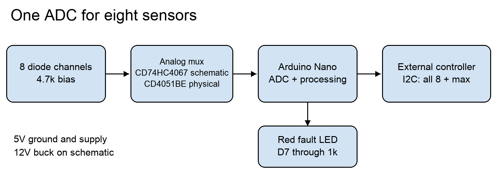

# Design Document for 8-Sensor Temperature Monitor

RFR Group 02 - October 18, 2026

## Circuit Description

Figure 1. One Arduino Nano ADC input reads eight diode channels through the multiplexer.

The design uses eight temperature-sensitive diodes. The Altium schematic keeps the originally specified CD74HC4067 multiplexer, with only channels 0 through 7 connected. The physical circuit uses the newly specified CD4051BE 8:1 multiplexer. The Arduino Nano selects each diode, reads its voltage through A0, and estimates its temperature using the Analog-to-Digital Converter (ADC). If a temperature exceeds 60 degrees Celsius or a sensor reading appears faulty, the Nano blinks a red LED. The readings are available over I2C.

This document describes a proposed design. It has not been built or tested. We do not know the exact part number for our diodes. At this time, we are estimating temperatures based upon example calibration values. Once we have the supplied diodes in the shop, we will measure them and update our calculations accordingly.

## Component Choices

Each diode has a 4.7 kOhm resistor placed between 5 volts and its anode. The cathode of each diode connects directly to ground. The voltage at the junction between the resistor and diode is the temperature signal. By giving each diode its own series resistor, we keep each diode biased while the multiplexer switches among channels. The common output of the multiplexer connects to Nano pin A0. Pins D2 through D4 control the three select lines. Pin D6 controls whether or not the multiplexer is enabled. On the schematic's CD74HC4067, S3 is tied to ground and channels 8 through 15 are unused.

The CD4051BE used on the breadboard has a different pinout from the CD74HC4067 shown on the schematic. Connect Nano D2, D3, and D4 to the CD4051BE A, B, and C inputs on pins 11, 10, and 9. Connect D6 to inhibit pin 6 and A0 to common pin 3. Connect 5 volts to VDD pin 16. Connect both VSS pin 8 and VEE pin 7 to ground. The eight diode signals connect to channel pins 13, 14, 15, 12, 1, 5, 2, and 4 in channel order from 0 to 7.

Since we expect the voltage across our diodes to be approximately 0.6 volts, we choose to use the 1.1-volt reference available within the Nano’s ADC rather than the default 5-volt reference. This choice results in smaller voltage increments compared to using the 5-volt reference. Additionally, we connect a 1-nanofarad capacitor to A0 to help filter out transient voltages caused by switching. Following a switch to a new channel, the software waits for 100 microseconds before performing a single conversion. Next, it takes eight additional conversions and calculates their average. While averaging reduces noise, it does nothing to improve calibration.

Pin D7 of the Nano is connected to a red LED through a 1-kiloohm resistor. Pins A4 and A5 provide the SDA and SCL lines for the I2C bus. Both lines have a 4.7-kiloohm pull-up resistor to 5 volts. The second device on the I2C bus must either support 5-volt signaling or be connected through a level translator. All ground connections should be tied together.

Our schematic shows a 12-to-5-volt switching regulator. For the breadboard, we will use the supplied regulated 5-volt source instead of physically building that regulator. The regulator remains in the schematic. A jumper selects either the regulator’s 5-volt output or the supplied 5-volt source. It must not connect both. Power is delivered to the Nano through its 5V pin, not its VIN pin.

## Pin Connections for the Nano

A0: Multiplexer output. D2-D4: Multiplexer channel select lines. D6: Multiplexer enable line. D7: Red LED through a 1-kiloohm resistor. A4 and A5: I2C SDA and SCL lines. D5 is unused.

## Temperature Calculations and Conversion

Assuming a typical diode voltage of 0.650 volts at 25 degrees Celsius, the current flowing through the 4.7-kiloohm resistor would be (5.0 - 0.650) / 4700 = 0.00093 amps or 0.93 milliamps. In total, all 8 diodes combined would draw approximately 7.4 milliamps. Assuming the red LED drops 2 volts, the current through the LED would be (5 - 2) / 1000 = 3 milliamps. Again, these are just rough estimates to allow us to compare against component specifications during construction.

The Nano’s ADC has 1024 possible values. Given a 1.1-volt reference, each value corresponds to approximately 1.1 / 1024 = 1.07 millivolts. Therefore, the estimated voltage can be calculated as V = ADC Value * 1.1 / 1024. If we assume a slope of -2 millivolts per degree Celsius, then each individual ADC step would correspond to approximately 0.54 degrees Celsius. Again, this represents resolution, not accuracy.

## Calibration Process

Prior to utilizing the system, we must calibrate each diode. To accomplish this task, we need to determine the voltage produced by each diode at two distinct temperatures. From there, we can calculate the slope as (V2 - V1) / (T2 - T1). Once we have determined the slope for each diode, we can utilize that slope along with a measurement taken at one of those measured temperatures to convert voltage to temperature. Prior to accepting the warning threshold, we recommend verifying a reading near 60 degrees Celsius. Ultimately, we must measure the actual reference voltage used by the Nano’s ADC. Until such time as we perform those measurements, the software will continue to report readings as being uncalibrated.

## Output Over I2C Interface

The Nano is designed to scan channels 0 through 7 about every 50 milliseconds. The actual timing still needs to be measured. Readings that fall outside of a predetermined range (near zero, saturated, etc.) are ignored. The maximum remaining temperature is reported. Should a sensor fail, the LED will blink. The warning light will illuminate once the temperature rises above 60 degrees Celsius and extinguish once the temperature falls to 58 degrees Celsius or lower if all sensors are functioning properly. A two-degree margin exists to prevent rapid on/off transitions near the threshold.

The Nano operates as an I2C slave device with a 7-bit address of 0x32. An external master device sends a page number (0 or 1) to the Nano. Following receipt of the page number, the Nano responds with 22 bytes of data. Page 0 contains the maximum temperature. Page 1 contains the temperatures for sensors 0 through 7. Each page starts with a version byte, followed by a page number byte, then a two-byte sequence number, a status byte, and a hottest-channel number byte. Each temperature is represented as a signed 16-bit integer value in hundredths of a degree Celsius. A value of -32768 indicates an invalid reading. The external controller should use pages with matching sequence numbers. Otherwise, it should read them again.

## Byte Layout

Bytes 0-1: version and page number. Bytes 2-3: scan sequence. Bytes 4-5: status flags and hottest channel. Page 0, bytes 6-7: maximum temperature. Page 1, bytes 6-21: temperatures for sensors 0-7. The unused bytes on Page 0 are zero. Status flags indicate a high temperature, sensor fault, incomplete calibration, and data availability.

## Remaining Tasks Before Demonstration

Identify the diodes and verify the Nano model. Check the 5-volt rail and diode polarity before applying power. Build one channel, then all 8 channels with the CD4051BE. Measure the ADC reference voltage and calibrate each diode, including a check near 60 degrees Celsius. Test every channel, the I2C output, the LED threshold, and the scan timing. Record the results.

The hardware and software deadline is Nov. 1. Testing is part of showing that the hardware and software work. It is not an Oct. 18 deadline.

Our Altium file opens in Altium Designer. However, we have not yet obtained a clean electrical rule check result or an Altium-native PDF export. The schematic PDF included with the project is a separate review copy. Currently, the virtual machine is displaying a Professional roaming license. Since this project requires a Student Edition license, the group needs to verify which type of license is acceptable to the reviewers.

## References

Texas Instruments CD74HC4067 and [CD4051BE data sheets](https://www.ti.com/lit/ds/symlink/cd4051b.pdf), Microchip ATmega328P data sheet, Arduino Nano pinout diagram, and RECOM R-78E-0.5 data sheet.
