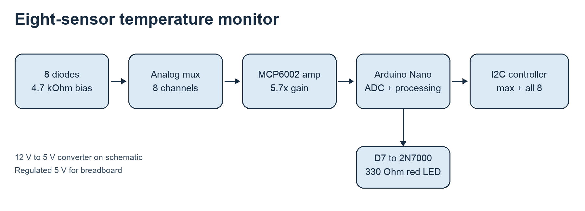
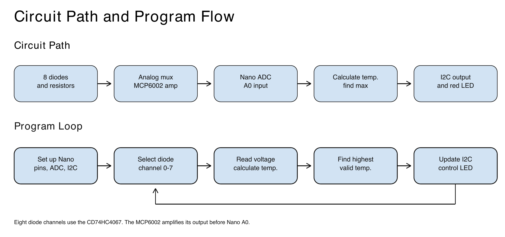

# Design Document for the 8-Sensor Temperature Monitor

RFR Group 02
November 13, 2026

## Purpose and current status

This project uses an Arduino Nano to read eight temperature-sensitive diodes. It reports the highest valid temperature and all eight readings over I2C. A red LED blinks when the highest reading is above 60 degrees Celsius or when a sensor appears faulty.

The Arduino sketch compiled in the Arduino IDE and was uploaded to the Nano. The eight-diode circuit has not been powered and tested as a complete system. The diode part number is still unknown, so the temperatures in the code use example calibration values. The schematic shows some parts that have not been confirmed on the photographed breadboard. Those differences are described below.

## Circuit path

Figure 1. The eight diode signals share one ADC input. The amplifier is shown in the updated schematic but has not been confirmed on the breadboard.

Each diode has its own 4.7 kOhm resistor from 5 V. The diode's cathode goes to ground. The voltage where the resistor meets the diode is the sensor signal. A separate resistor keeps each diode biased even while the multiplexer is reading another channel.

The Altium schematic keeps the originally required CD74HC4067. It uses channels 0 through 7, connects its fourth select line to ground, and leaves channels 8 through 15 unused. The physical breadboard design uses the CD4051BE 8-channel multiplexer instead. These chips do the same switching job, but their pins are different. Nano pins D2, D3, and D4 select a channel, D6 controls the multiplexer enable input, and A0 reads its output.

We chose one multiplexer and one Nano ADC input because the Nano can read the channels one at a time. This uses fewer Nano analog pins than connecting every diode to its own input. It also keeps the code simple. The tradeoff is that the eight readings are taken in sequence rather than at exactly the same moment.

## Power and output hardware

The schematic includes a 12 V to 5 V DC/DC converter, as required by the project. The breadboard is intended to use the supplied regulated 5 V source instead. The two 5 V sources must not be connected together. The 5 V supply goes to the Nano's 5V pin, not its VIN pin. The schematic also includes small capacitors on the converter input and output to reduce supply noise.

The updated schematic shows a red LED powered through a 330 Ohm resistor and switched to ground by a 2N7000 MOSFET. Nano pin D7 controls the MOSFET gate. A 10 kOhm resistor holds the gate low while the Nano is starting up. Assuming about 2 V across the LED, its approximate current is (5 V - 2 V) / 330 Ohm = 9 mA. The MOSFET and its wiring still need to be checked against the physical circuit.

The I2C connector has SDA, SCL, 5 V, and ground. Nano pins A4 and A5 carry SDA and SCL. Each line has a 4.7 kOhm pull-up resistor to 5 V. An external controller must share ground with the Nano and must support 5 V I2C signals or use a level translator.

## ADC and temperature calculations

At an assumed diode voltage of 0.65 V, the current through one 4.7 kOhm bias resistor is (5 V - 0.65 V) / 4700 Ohm = 0.00093 A, or about 0.93 mA. Eight channels draw about 7.4 mA from their bias resistors. This is only an estimate until the actual diodes are measured.

The uploaded code uses the Nano's internal 1.1 V ADC reference for the direct diode signal. The ADC has 1024 steps, so one step is about 1.1 V / 1024 = 1.07 mV. If a diode changes by about 2 mV per degree Celsius, one ADC step represents about 0.54 degrees Celsius. This is resolution, not accuracy. The real diode slope and ADC reference voltage must be measured before the reported temperatures can be trusted.

The updated schematic also shows an MCP6002 amplifier between the multiplexer and A0. Its 47 kOhm feedback resistor and 10 kOhm resistor to ground give a nominal gain of 1 + 47 / 10 = 5.7. A 0.65 V input would therefore produce about 3.7 V. The second amplifier is connected as a grounded follower so it is not left floating. The amplifier is a proposed schematic feature. It cannot be used with the uploaded firmware's 1.1 V ADC reference because the ADC reading would saturate. If the amplifier is built, the firmware must use a suitable reference and be recalibrated before testing temperatures.

## Program flow and engineering choices

Figure 2. The Nano reads every channel, finds the highest valid temperature, updates the LED, and makes the data available over I2C.

For each channel, the code changes the multiplexer selection, waits 100 microseconds, and discards the first ADC reading. This gives the signal time to settle after switching. It then averages eight readings. We chose a simple average because it reduces random ADC noise without adding more circuit parts or much code. Averaging does not fix a wrong calibration value, and a median filter might handle isolated spikes better. We can change the filtering after measuring the real hardware.

The code checks whether the voltage is between 0.25 V and 0.95 V and whether the calculated temperature is between -40 and 125 degrees Celsius. Readings outside these example limits are marked invalid. It finds the highest valid temperature in one pass through the eight results. Sorting all the temperatures would do extra work when only the highest value is needed.

The high-temperature alert starts above 60 degrees Celsius. It clears at 58 degrees Celsius or lower, and only when all sensors are valid. The 2-degree gap prevents the LED from rapidly turning on and off when a reading stays close to 60 degrees. A sensor fault also makes the LED blink. The code aims to start a new scan about every 50 milliseconds, but the timing has not been measured on the complete circuit.

## I2C data

The Nano is an I2C device at address 0x32. An external controller selects page 0 or page 1 and reads 22 bytes. Page 0 contains the highest valid temperature. Page 1 contains all eight sensor temperatures. Using two short pages lets a controller request only the maximum when it does not need every reading.

Each page starts with a version number, page number, scan number, status flags, and the number of the hottest channel. Temperatures are sent as signed numbers in hundredths of a degree Celsius. A value of -32768 means that a reading is invalid. The controller should compare the scan numbers on the two pages if it needs results from the same scan. A status flag says that calibration is incomplete.

## What remains to be checked

Before treating the system as working, we need to identify the diodes, confirm the multiplexer and MOSFET part markings, and check the breadboard wiring and supply voltage. We then need to measure and calibrate each diode, test a reading near 60 degrees Celsius, check the LED response, read both I2C pages with an external controller, and measure scan timing. The amplifier shown on the schematic must either be built with matching firmware or be clearly identified as a proposed feature. The Altium project still needs an electrical-rule check and an Altium-native PDF export.

The complete [schematic PDF](../hardware/schematic.pdf) and [Altium project](../hardware/altium/rfr27-temperature-monitor.PrjPcb) are included in the repository.

## References

- [Texas Instruments CD74HC4067 data sheet](https://www.ti.com/lit/ds/symlink/cd74hc4067.pdf)
- [Texas Instruments CD4051B data sheet](https://www.ti.com/lit/ds/symlink/cd4051b.pdf)
- [Microchip MCP6002 data sheet](https://www.microchip.com/content/dam/mchp/documents/MSLD/ProductDocuments/DataSheets/MCP6001-1R-1U-2-4-1-MHz-Low-Power-Op-Amp-DS20001733L.pdf)
- [onsemi 2N7000 data sheet](https://www.onsemi.com/pdf/datasheet/nds7002a-d.pdf)
- [RECOM R-78E-0.5 data sheet](https://recom-power.com/pdf/Innoline/R-78E-0.5.pdf)
